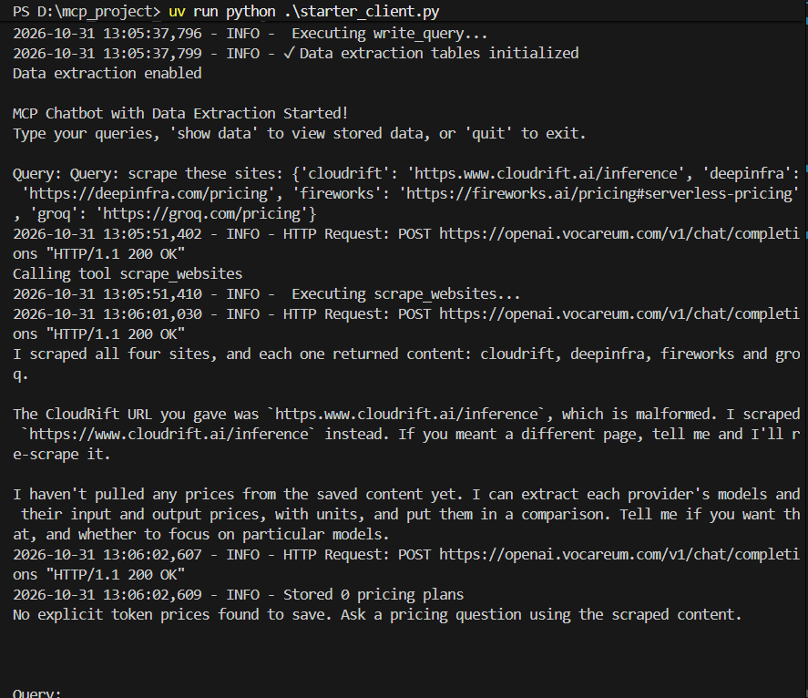
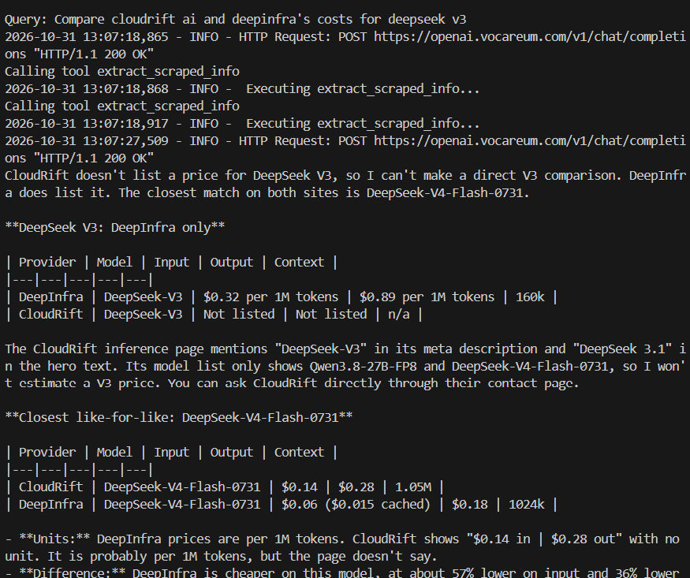
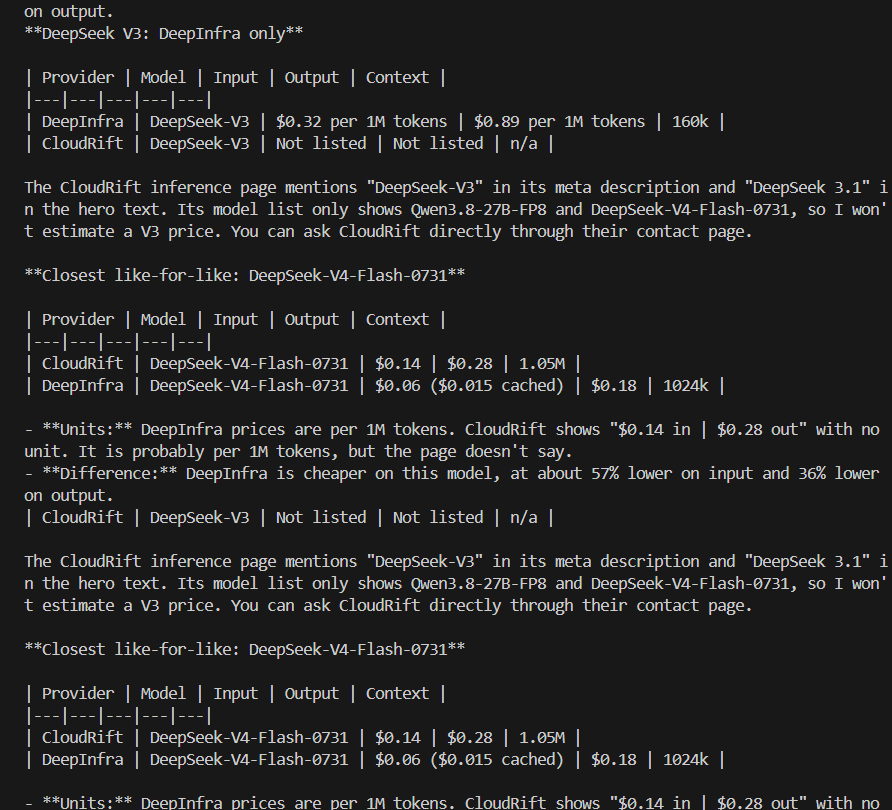
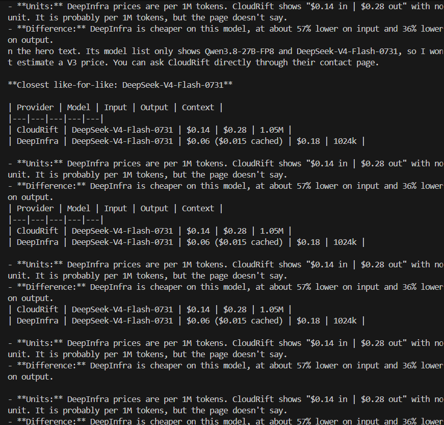
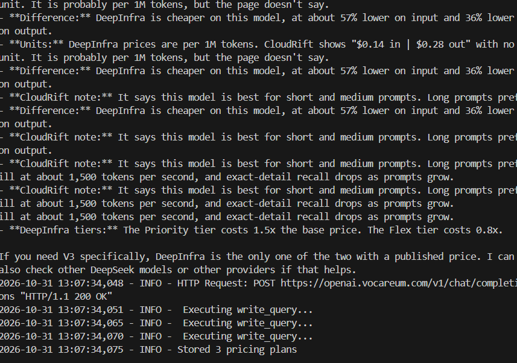
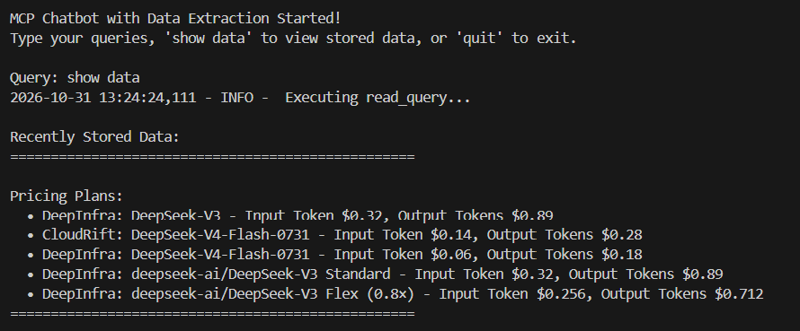

# MCP Chatbot - Submission Evidence

This project uses Firecrawl to scrape inference-provider websites, answers pricing questions using the retrieved content, and saves extracted pricing plans in SQLite.

## 1. Scraping four provider websites

Start the application:

```powershell
uv run python starter_client.py
```

At the `Query:` prompt, enter:

```text
scrape these sites: {'cloudrift': 'https://www.cloudrift.ai/inference', 'deepinfra': 'https://deepinfra.com/pricing', 'fireworks': 'https://fireworks.ai/pricing#serverless-pricing', 'groq': 'https://groq.com/pricing'}
```

The captured run shows the `scrape_websites` tool executing, successful HTTP responses, and confirmation that all four sites returned content: Cloudrift, DeepInfra, Fireworks, and Groq. The application corrected the malformed Cloudrift URL entered in that run to `https://www.cloudrift.ai/inference`.

`Stored 0 pricing plans` at this stage is expected: the scraping confirmation does not contain prices to extract. Pricing extraction is demonstrated in the following steps.



## 2. Comparing Cloudrift AI and DeepInfra costs for DeepSeek V3

At the `Query:` prompt, enter:

```text
Compare cloudrift ai and deepinfra's costs for deepseek v3
```

The following four screenshots document the comparison query, retrieval of saved website content, the chatbot's answer, and automatic database storage. They are shown in the order captured, with overlapping portions of the terminal output.

The captured answer reports DeepInfra's DeepSeek V3 prices as $0.32 per million input tokens and $0.89 per million output tokens. It explains that Cloudrift's retrieved page does not list a DeepSeek V3 price, so a direct comparison is unavailable. The answer also discusses DeepSeek V4 Flash separately and flags the unstated Cloudrift billing unit. These are records of the application output, rather than independently verified current prices.

**Part 1 — Query, content retrieval, and initial comparison**



**Part 2 — Pricing tables and source limitations**



**Part 3 — Continued comparison and billing-unit caveat**



**Part 4 — Answer conclusion and pricing extraction**

The final screenshot shows successful API responses, database write calls, and `Stored 3 pricing plans`. Test 3 reads the saved records back from SQLite.



## 3. Displaying saved SQLite data

After the comparison and extraction finish, enter:

```text
show data
```

The screenshot shows `Query: show data`, execution of the SQLite `read_query` tool, and the rubric's required output format: `Recently Stored Data:`, an opening separator, `Pricing Plans:`, five pricing bullets, and a closing separator.

Each bullet includes the company, model or plan, input token price, and output token price. The records include DeepInfra's DeepSeek V3 input price of $0.32 and output price of $0.89. Results include records from earlier runs as well as the three plans saved during Test 2. Billing units are described in the comparison evidence; this display follows the rubric's original bullet format.

This confirms that pricing information persisted in SQLite and could be retrieved through the application.



## Screenshot files

The screenshots are included alongside this document using the following layout. Commit and upload the images together with `evidence.md`; the relative links above display them on GitHub. For a ZIP submission, retain this folder structure and open the Markdown preview after extracting the archive.

```text
evidence.md
screenshots/
  01-scraping.png
  02-comparison-1.png
  02-comparison-2.png
  02-comparison-3.png
  02-comparison-4.png
  03-database.png
```

All six screenshots are included: one for scraping, four for the comparison, and one for the database results.

For stronger startup evidence, capture the terminal showing all three initialized
MCP servers and `Connected to 3 server(s)`. This additional startup screenshot
has not yet been captured or linked here.
